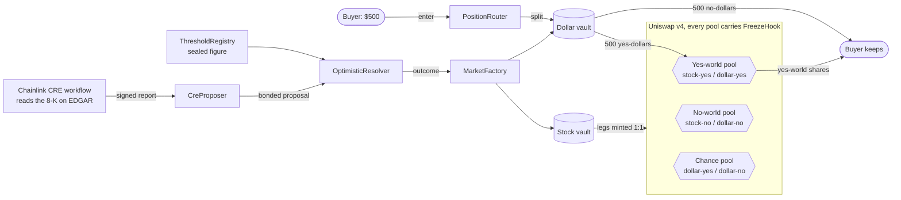
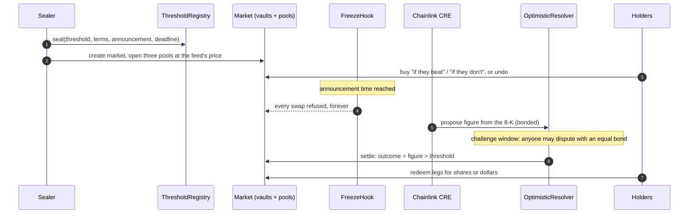

# Cuspate

**Buy it only if.**

Cuspate lets you buy a stock only if a condition is met. Buy Tesla only if Tesla's Q3 adjusted EPS is above $0.43: if it is, you own the shares; if it is not, your dollars come back. Until the announcement you can undo the purchase and take your dollars out.

[](https://cuspate.xyz)
[](#chainlink-cre-reads-the-filing)
[](#uniswap-v4-prices-both-worlds)
[](#envio-indexes-every-market)
[](contracts)
[](#license)

[App](https://cuspate.xyz) | [How it works](#how-a-position-works) | [Lifecycle](#how-a-market-lives) | [Sponsor tech](#built-with) | [Contracts](#deployed-contracts) | [Run it](#run-it-locally) | [Security](#security-notes)

---

## The idea

Most people who hold dollars on chain have never traded an option, and many investing apps do not offer listed options at all. Yet the thing many of them want is simple: "I would buy this stock if the company has a good quarter."

Cuspate turns that sentence into one transaction. Every condition is a market on a single company figure, sealed on chain before the event:

| Condition | Figure | Threshold |
|---|---|---|
| Tesla, Q3 2026 | non-GAAP (adjusted) diluted EPS | above $0.38, $0.43, $0.48 or $0.53 |
| Meta, Q3 2026 | GAAP diluted EPS | above $5.51, $6.39, $7.27 or $8.15 |

Both companies report on October 21, 2026, after the close. Trading in these eight markets freezes at 4:00 pm ET that day. Tesla publishes an adjusted EPS, so its middle condition is labelled "beats expectations". Meta publishes no adjusted figure, so its markets settle on GAAP EPS and only ever say "EPS above".

A condition is met only if the reported figure is strictly above the threshold. Exactly the threshold does not count.

## How a position works

Each market splits the world in two: the world where the condition is met ("yes") and the world where it is not ("no"). The stock and the dollar each get a token for each world, so a market has four legs:

| Leg | Pays out if yes | Pays out if no |
|---|---|---|
| stock, yes world | 1 share | nothing |
| stock, no world | nothing | 1 share |
| dollar, yes world | $1 | nothing |
| dollar, no world | nothing | $1 |

One yes leg and one no leg of the same asset always merge back into that asset, at any time. That rule is what makes a conditional purchase possible.

When you buy "if they beat" with $500, the router does this in a single call:

1. Splits your $500 into 500 yes-dollars and 500 no-dollars.
2. Sells all 500 yes-dollars for yes-world shares of the stock, in that world's Uniswap v4 pool.
3. Sends you the yes-world shares and the 500 no-dollars.

If the figure comes in above the threshold, your yes-world shares redeem one for one into the stock and the no-dollars are worth nothing. If it does not, the shares are worth nothing and the 500 no-dollars redeem into $500. "If they don't" is the mirror image.

The two worlds are priced separately, and their prices add up to the stock's real price. The interface shows that sum next to the feed's price on every market, so anyone can check there is no hidden spread.



The third pool pairs the two dollar legs. Since one of each always merges into a dollar, its price is the market's implied chance of "yes". The app shows that price as a percentage next to each condition.

## How a market lives



1. **Seal.** The sealer writes the threshold, the full terms and the announcement time into `ThresholdRegistry`. The event id is a hash of all of it plus the sealer's address, so there is nothing to edit afterwards: a different number would be a different event. The registry has no owner, no proxy and no delete. The terms name the issuer and its SEC CIK, the exact figure, the period, the primary source (exhibit 99.1 of the issuer's Form 8-K on SEC EDGAR) and a fallback source.
2. **Trade.** `MarketFactory` creates the market permissionlessly: two `PositionVault`s (stock and dollar), four `PositionToken` legs, and three Uniswap v4 pools registered with `FreezeHook`. Buyers enter and undo through `PositionRouter`. Each market has a fixed size cap set at creation.
3. **Freeze.** At the sealed announcement instant, `FreezeHook` refuses every swap in the market's three pools, and it never reopens them. A result is a price jump that nobody can hedge against inside a block, so the pools stop trading before the figure can exist. Liquidity is never locked: providers can withdraw at any time.
4. **CRE proposes.** Every ten minutes the Chainlink CRE workflow checks whether an issuer is due. When the 8-K under item 2.02 appears on EDGAR, each node reads the press release (the document typed `EX-99.1`), extracts the figure from two places in it that must agree, and the network agrees on the result. The DON delivers a signed report to `CreProposer`, which posts a bond and proposes the figure to `OptimisticResolver`. Anyone else may propose too.
5. **Challenge window.** Anyone may dispute a proposal by posting an equal bond. A first dispute discards the proposal and reopens the event; a dispute of the second proposal goes to the arbiter. Whoever was right gets both bonds less a fixed burn.
6. **Settle.** A proposal nobody disputes settles. The resolver compares the figure to the sealed threshold exactly (never rounded, sign included) and reports the outcome to `MarketFactory`. Every market over the same event reads that one outcome.
7. **Redeem.** Holders redeem their legs at the vaults: the winning world's legs pay one for one, the other world's pay nothing.

Every way an event can stall has an exit anyone can take without a bond. An event nobody resolves expires invalid after its deadline plus a grace period. An event the arbiter never rules expires invalid once the timeout passes, with both bonds returned. Under an invalid outcome every leg redeems half, so each holder gets back their share of what the vaults hold.

On the test deployment the bond is 10 test dollars, the burn is 2, the challenge window is 10 minutes, the arbiter has 2 hours to rule, and an event can still be proposed for 1 day after its deadline. These are fixed in the resolver's constructor and cannot change.

## Built with

### Monad runs everything on chain

The whole protocol, every market and every position lives on Monad. The live deployment is on **Monad testnet (chain id 10143)**, with test dollars and test shares that carry no value. Monad charges the gas limit of a transaction rather than the gas used, so every user-facing entry point in the contracts has a measured gas budget and a fixed limit, checked in CI (`contracts/snapshots`, `tools/budgets.sh`).

### Chainlink CRE reads the filing

[`cre/resolver-proposer`](cre/resolver-proposer) is a Chainlink Runtime Environment workflow, written in TypeScript and compiled to WebAssembly.

| What | Where |
|---|---|
| Entry point and the cron trigger, every 10 minutes | [`main.ts`](cre/resolver-proposer/main.ts), [`workflow.ts`](cre/resolver-proposer/workflow.ts) |
| EVM reads of the resolver and the registry at the last finalized block, and the report write | [`chain.ts`](cre/resolver-proposer/chain.ts) |
| Finding the release on EDGAR: the issuer's 8-K feed, then the filing index that names the `EX-99.1` exhibit | [`edgar.ts`](cre/resolver-proposer/edgar.ts) |
| HTTP fetches, gzip-decompressed and bounded at 2 MB, with identical-result consensus across nodes | [`fetch.ts`](cre/resolver-proposer/fetch.ts) |
| Per-issuer readers: where each release states the figure, and a second place that must agree | [`source.ts`](cre/resolver-proposer/source.ts), [`issuers/`](cre/resolver-proposer/issuers) |
| The signed report `(eventId, figure, decimals)` lands in `CreProposer.onReport` through the KeystoneForwarder | [`contracts/src/CreProposer.sol`](contracts/src/CreProposer.sol) |

The workflow only proposes. It abstains whenever something is off (event not sealed by the expected sealer, terms that differ byte for byte, no filing yet, two statements of the figure that disagree, more decimals than the threshold) and logs a one-line reason per event. The resolver's rules still let anyone propose, dispute and settle, so the workflow is one proposer among any number, and its proposals can be disputed like anyone's.

`CreProposer` accepts reports only from the production KeystoneForwarder and only for one workflow owner and name. It posts each bond from its own balance, and anyone can sweep the bonds it earns back to the treasury.

The workflow `cuspate-resolver-proposer` is registered on the CRE Workflow Registry by owner `0x040e0FCf01BC56Abe785C56D5b1cBe40f3AdFeE4` and delivers to `CreProposer` at `0x18fC5360598FeED231B2A4936ab72bfc4daA34B7`, which holds bonds for fifty proposals.

### Uniswap v4 prices both worlds

Each market opens three v4 pools, all carrying [`FreezeHook`](contracts/src/FreezeHook.sol):

- the yes-world pool, stock-yes against dollar-yes;
- the no-world pool, stock-no against dollar-no;
- the chance pool, dollar-yes against dollar-no.

The hook implements `beforeInitialize` (only a registered market's three canonical pools can be created with it) and `beforeSwap` (no swap after the market's sealed freeze instant). It holds no funds, returns no delta and never calls the pool manager. One guardian may bring a freeze forward to now, for a moved announcement or an emergency; nobody can delay a freeze or reopen a pool.

[`PositionRouter`](contracts/src/PositionRouter.sol) talks to the `PoolManager` directly through `unlock`, so a purchase is one call and one signature: split, swap with a minimum-output floor and a deadline, deliver. [`ConditionalPools`](contracts/src/ConditionalPools.sol) derives the pool keys from the market, so the router can only touch the hooked pools.

### Envio indexes every market

[`indexer/`](indexer) is an Envio HyperIndex project, hosted on Envio's cloud and reading Monad testnet through HyperSync from the deployment block. Its schema ([`schema.graphql`](indexer/schema.graphql)) covers markets, vaults, legs, balances, pools, swaps, liquidity, entries, exits, seals, proposals and resolutions, built only from the contracts' events. The app reads its markets from it. The public endpoint:

```
https://indexer.dev.hyperindex.xyz/01b8595/v1/graphql
```

```graphql
{
  Seal(order_by: { announcesAt: asc }) { id value decimals announcesAt deadline }
  Pool(limit: 6) { id market kind freezesAt sqrtPriceX96 }
}
```

A reconciliation run ([`tools/indexer.sh`](tools/indexer.sh)) takes a market through its whole life on a fork, indexes it, and compares every entity with what the contracts answer.

### Privy signs people in with an email

Anyone can sign in with an email address: Privy sends a one-time code and creates an embedded wallet for that user. The app's server route ([`web/app/api/sponsor`](web/app/api/sponsor/route.ts)) then sends that user's actions from their own wallet with the gas paid. It reads the user from the verified session, accepts only calls to Cuspate's own contracts whose arguments pay nobody but the user, simulates the batch first, and counts it against a per-user daily limit (20 batches) and a global monthly one. A buy is one confirmation and costs the user no gas. People who already have a browser wallet can connect it instead and pay their own gas.

### NEAR Intents bring dollars from other chains

The deposit page ([`/fund`](https://cuspate.xyz/fund)) uses the NEAR Intents 1Click API. A user picks USDC or USDT on Base, Arbitrum, Ethereum, Optimism, Polygon or Avalanche, gets a real quote with a deposit address, and the funds arrive as USDC on Monad mainnet at their own address. The service key stays on the server ([`web/src/server/oneclick.ts`](web/src/server/oneclick.ts)); refunds go back to the same address on the source chain. The test markets themselves trade in test dollars.

### Keeper and alerts

[`keeper/`](keeper) keeps each market's implied stock price within a band around the stock's price feed. When the sum of the two worlds drifts outside the band, it makes one atomic correction from its own Safe through `MultiSendCallOnly`, sized from quotes and protected by floors, and it never sends the same correction twice across restarts or parallel instances. It also makes the resolver's permissionless follow-ups (`settle`, `expire`, `release`) once they are due. Its watchers read the chain at the finalized block and raise alerts: critical when a vault holds less than it owes or the feed is wrong, a warning when something needs a person.

On the testnet the feed is `TestnetStockOracle`, onto which [`ops/src/publisher.ts`](ops/src/publisher.ts) mirrors the production feed's prices every quarter hour of the regular session, so the test markets trade around real prices.

## Architecture

```
Cuspate/
|-- contracts/        Foundry. The protocol, its tests (unit, fuzz, invariant, fork) and the deployment record
|   |-- src/          ThresholdRegistry, MarketFactory, PositionVault, PositionToken, FreezeHook,
|   |                 ConditionalPools, PositionRouter, OptimisticResolver, CreProposer
|   |-- src/testnet/  Test dollar with a faucet, test stocks, test price feed, report probe
|   `-- deployments/  10143.json: every address, block, commit and transaction, written from receipts
|-- cre/              Chainlink CRE workflow that reads EDGAR and proposes the figure
|-- indexer/          Envio HyperIndex: schema, handlers, per-network configs
|-- keeper/           Price-band keeper, resolver follow-ups, watchers and alerts
|-- ops/              Deployment runbook, market opening, price publisher, generated service configs
|-- packages/shared/  Issuer profiles and the canonical renderer for a market's terms
|-- web/              Next.js app: markets, order ticket, portfolio, deposits, disclosures, comparison
|-- test/             Repository-level checks of the CI gates and tripwires
`-- tools/            ci.sh, test.sh, deploy.sh and the jobs that need a fork or a network
```

| Layer | Stack |
|---|---|
| Contracts | Solidity 0.8.26, Foundry, OpenZeppelin, Uniswap v4-core, Safe |
| Resolution | Chainlink CRE SDK (TypeScript to WASM), SEC EDGAR |
| Indexing | Envio HyperIndex 3, HyperSync, hosted on Envio Cloud |
| App | Next.js 16, React 19, wagmi 3, viem 2, Privy |
| Deposits | NEAR Intents 1Click |
| Chain | Monad testnet (10143) |

## Deployed contracts

Monad testnet, chain id 10143. Explorer: [testnet.monadexplorer.com](https://testnet.monadexplorer.com). Every entry comes from [`contracts/deployments/10143.json`](contracts/deployments/10143.json), which `tools/deploy.sh` writes only from a mined receipt. All contracts were deployed through the deterministic CREATE2 factory.

### Protocol

| Contract | Address | Role |
|---|---|---|
| ThresholdRegistry | [`0x3c90A044CdA45f1d337C7f3C6ca9D2DE7A2025cE`](https://testnet.monadexplorer.com/address/0x3c90A044CdA45f1d337C7f3C6ca9D2DE7A2025cE) | Seals each event's threshold and terms, forever |
| MarketFactory | [`0x9FE30879AC1744197D8bf1338b707e840D25f43C`](https://testnet.monadexplorer.com/address/0x9FE30879AC1744197D8bf1338b707e840D25f43C) | Creates markets and records outcomes |
| OptimisticResolver | [`0xcB4c8151F2183D8b98cCb36825C629ab420140ad`](https://testnet.monadexplorer.com/address/0xcB4c8151F2183D8b98cCb36825C629ab420140ad) | Bonded proposals, disputes, arbitration, settlement |
| FreezeHook | [`0x1E6e38d5af4B5aD1f3C668411bD17C3F8D06a080`](https://testnet.monadexplorer.com/address/0x1E6e38d5af4B5aD1f3C668411bD17C3F8D06a080) | Uniswap v4 hook that stops swaps at the announcement |
| PositionRouter | [`0x80b38767D951170723291faC506348EFF7935a35`](https://testnet.monadexplorer.com/address/0x80b38767D951170723291faC506348EFF7935a35) | Buys and undos in one call |
| CreProposer | [`0x18fC5360598FeED231B2A4936ab72bfc4daA34B7`](https://testnet.monadexplorer.com/address/0x18fC5360598FeED231B2A4936ab72bfc4daA34B7) | Receives Chainlink CRE reports and proposes with a bond |

### Test assets

| Contract | Address |
|---|---|
| TestnetDollar (6 decimals, faucet of 1,000 per day) | [`0x1125aB2e77C8d4E4082f690176cE8604088813E7`](https://testnet.monadexplorer.com/address/0x1125aB2e77C8d4E4082f690176cE8604088813E7) |
| TestnetStock TSLA | [`0xaA466633cF7934DBa9B46d50DEE8ED9d66E610E7`](https://testnet.monadexplorer.com/address/0xaA466633cF7934DBa9B46d50DEE8ED9d66E610E7) |
| TestnetStock META | [`0x0C0A46C76176548E0398339Bab28055F4DD32e50`](https://testnet.monadexplorer.com/address/0x0C0A46C76176548E0398339Bab28055F4DD32e50) |
| TestnetStockOracle | [`0x4CB07861A30785257eD9BB7aAbA8Cc90DCa90F24`](https://testnet.monadexplorer.com/address/0x4CB07861A30785257eD9BB7aAbA8Cc90DCa90F24) |
| TestnetReportProbe | [`0x0a682e74Bc8F526b460175e2EE7Fb1347D2e0518`](https://testnet.monadexplorer.com/address/0x0a682e74Bc8F526b460175e2EE7Fb1347D2e0518) |

### Markets

Each market's vaults, legs, pools and seal, creation and seeding transactions are listed under `markets` in the deployment record.

| Market | Market id | Opening chance |
|---|---|---|
| `tsla-q3-2026/above-0-38` | `0xb3450c8f347159d6cb675d825633162ff9d6161aea1a77e15cb82db9f4e0efe9` | 0.75 |
| `tsla-q3-2026/above-0-43` | `0x38514acbb12d2ba5ac25a5bd716629fca1ba889d4b4debfd46714ca41ef9484c` | 0.50 |
| `tsla-q3-2026/above-0-48` | `0x23ab8532b27fa51ee092fbee889421133a8c41e68e30ed6a15959b4138e3202f` | 0.25 |
| `tsla-q3-2026/above-0-53` | `0xc103eafb1784fa8d97e493eb39faf4ee97562e5317bbf127213ffa23086352d6` | 0.10 |
| `meta-q3-2026/above-5-51` | `0xfdaec498363617a89cefe2db1fdc356e1800e368316544ba20c1ad48491dea30` | 0.75 |
| `meta-q3-2026/above-6-39` | `0xefa8af9976db5f6686a686aa6b3550251ee42f78950ffe8b67d11b5392a48d82` | 0.50 |
| `meta-q3-2026/above-7-27` | `0xdd3e8f0fe96d7c063be12c84610ba41fe890f67bd88372f00884108309799117` | 0.25 |
| `meta-q3-2026/above-8-15` | `0x2db0f23d283837779a35e10db4e9c5887233536065f7d81b535dbd9c10c295de` | 0.10 |

### Roles

| Role | Safe | Can do |
|---|---|---|
| sealer | [`0x0cF9E0C15Bfed2F6260F3e58553926304E320ffA`](https://testnet.monadexplorer.com/address/0x0cF9E0C15Bfed2F6260F3e58553926304E320ffA) | Seal thresholds. Once sealed, nobody can change one, the sealer included. |
| guardian | [`0x50b4aABa9e58270EfaBD089B980d9bDE9E85e698`](https://testnet.monadexplorer.com/address/0x50b4aABa9e58270EfaBD089B980d9bDE9E85e698) | Bring a market's freeze forward to now. Cannot move funds or change an outcome. |
| arbiter | [`0xCf855Ea701f50f8889e095d454737C6ED25fb873`](https://testnet.monadexplorer.com/address/0xCf855Ea701f50f8889e095d454737C6ED25fb873) | Rule a twice-disputed event and each disputed contest, once each, with a stored reason. |
| treasury | [`0x5FEfA82f1D6C5aDf0A47Fd3473Dc1a9B38107Bae`](https://testnet.monadexplorer.com/address/0x5FEfA82f1D6C5aDf0A47Fd3473Dc1a9B38107Bae) | Owns the pools' liquidity positions and receives swept bonds. |
| keeper | [`0x1cda0972C9EAF93C09216B28Ebc2FFbf010046e1`](https://testnet.monadexplorer.com/address/0x1cda0972C9EAF93C09216B28Ebc2FFbf010046e1) | Trades like anyone else. The contracts give it no special power. |

### Third-party contracts used

| Contract | Address |
|---|---|
| Uniswap v4 PoolManager | `0x451D64ab3b650040d2aE1886602b97ed6eDc643d` |
| Uniswap v4 PositionManager | `0x3Bb14E3D0Cd50aBe3EdACa06d06c29C78676C31A` |
| Uniswap v4 Quoter | `0x869834d127b230283fe63E0d0A9bEB67216a94C7` |
| Uniswap v4 StateView | `0xB639209539c61BaF67AC04876315786F8D0b153c` |
| Uniswap Universal Router | `0x1b7bFCd2870329B987191910D85c22C7287f3c22` |
| Permit2 | `0x000000000022D473030F116dDEE9F6B43aC78BA3` |
| Chainlink KeystoneForwarder | `0xF8344CFd5c43616a4366C34E3EEE75af79a74482` |
| Safe singleton | `0x29fcB43b46531BcA003ddC8FCB67FFE91900C762` |

## Run it locally

Requirements: Node 24, pnpm 12, Foundry. Building and testing need no secret and no credential.

```sh
git clone https://github.com/DavidZapataOh/Cuspate.git
cd Cuspate
pnpm install
pnpm build          # contracts and the web app
pnpm test           # every Solidity selection plus the repository suite
```

```sh
tools/test.sh unit        # Solidity unit tests
tools/test.sh fuzz        # property tests
tools/test.sh invariant   # invariant suites
tools/test.sh fork        # against a fork of Monad, reads a public endpoint
tools/ci.sh               # every gate exactly as CI runs it: build, format, lint, docs,
                          # licences, size, gas budgets, coverage floors
tools/ci.sh coverage      # one gate
```

Each workspace has its own tests:

```sh
pnpm --filter cuspate-cre run test       # the workflow against recorded EDGAR releases
pnpm --filter cuspate-cre run e2e        # compiled workflow in the CRE simulator, real EDGAR, local chain (needs CRE_API_KEY)
pnpm --filter cuspate-web run test
tools/web.sh        # Playwright in three browser engines, then a purchase on a fork of the testnet
tools/keeper.sh     # keeper on a fork: corrections, follow-ups, no double send
tools/indexer.sh    # a full market life indexed and reconciled with the chain
tools/ops.sh        # deployment rehearsals on forks of both networks, never broadcasts
```

To run the app against the live testnet, copy `.env.example` to `.env`, set `MONAD_TESTNET_RPC_URL` and `INDEXER_GRAPHQL_URL` (the public Envio endpoint above), and run `pnpm --filter cuspate-web run build && pnpm --filter cuspate-web run start`. Email sign-in, sponsored gas and deposit quotes need your own Privy and 1Click credentials; browser wallets work without them.

## Security notes

- Nothing can move a sealed threshold. The event id commits to the threshold, the terms and the sealer. `ThresholdRegistry` has no owner, no proxy and no self-destruct.
- No upgradeable contracts. Every resolver parameter is fixed at construction, because each market's condition commits to the resolver's address.
- No privileged path to user funds. No role can take a position or redirect a payout. The router holds no funds and no state between calls, and the payer is always `msg.sender`.
- Every swap has a floor and a deadline. A CI tripwire fails the build if any function that reaches a swap can run without both.
- **Every restricted function has a negative test**, and every state-changing function documents who may call it (`@custom:access`). CI also enforces per-contract coverage floors and gas budgets.
- Liveness is permissionless. `settle`, `expire` and `release` can be called by anyone, so no role can hold an event open forever.
- Single-key roles on testnet. On this test deployment every role is a Safe with a 1-of-1 threshold. The sealer, guardian, arbiter and treasury Safes are all owned by the deployer key `0xD521E05AEbB8d39087bC7B9101CD590177468fca`; the keeper's Safe is owned by a separate key. Whoever holds the deployer key could freeze a market early or, as arbiter, rule a disputed figure wrongly. It cannot change a sealed threshold or touch a holder's position. The app's disclosures page says the same.
- Not audited. The contracts are new and have not had an external audit.

Security reports: ops@cuspate.xyz.

## License

The repository is under the [MIT License](LICENSE). The contracts in [`contracts/`](contracts) are under the [Business Source License 1.1](contracts/LICENSE), converting to GPL-2.0-or-later on 2030-10-01.

---

Buy it only if. [cuspate.xyz](https://cuspate.xyz)
